<a href="https://papertoanything.com">
<picture>
  <source media="(prefers-color-scheme: dark)" srcset="assets/hero-dark.svg">
  
</picture>
</a>

 

<picture>
  <source media="(prefers-color-scheme: dark)" srcset="assets/corpus-dark.svg">
  
</picture>

 

<picture>
  <source media="(prefers-color-scheme: dark)" srcset="assets/fortune-dark.svg">
  
</picture>

 

<a href="https://papertoanything.com">papertoanything.com</a>
