<picture>
  <source media="(prefers-color-scheme: dark)" srcset="assets/hero-dark.svg">
  
</picture>

 

<picture>
  <source media="(prefers-color-scheme: dark)" srcset="assets/section-now-dark.svg">
  
</picture>

I research AI safety, mostly the question underneath the headline results: **is the measurement measuring what we think it is?** Lately that means linear probes that may be reading words rather than internal states, welfare evaluations a model can recognise as tests, and coding agents that pass the suite without doing the work.

I also build software that has to survive being checked: a certified optimisation engine, a tool that finds the cryptography inside compiled binaries, and forensics for agents that collude. Most of it lives under [Paper To Anything](https://papertoanything.com).

AI Safety Camp researcher&nbsp;&nbsp;·&nbsp;&nbsp;TARA Bengaluru city organiser

 

<picture>
  <source media="(prefers-color-scheme: dark)" srcset="assets/section-work-dark.svg">
  
</picture>

  <a href="https://github.com/dhruva137/passing-isnt-proof"><picture><source media="(prefers-color-scheme: dark)" srcset="assets/work-1-dark.svg"></picture></a>
  <a href="https://github.com/dhruva137/Q.E.N.I.V.O"><picture><source media="(prefers-color-scheme: dark)" srcset="assets/work-2-dark.svg"></picture></a>
  <a href="https://github.com/dhruva137/V.E.R.A"><picture><source media="(prefers-color-scheme: dark)" srcset="assets/work-3-dark.svg"></picture></a>
  <a href="https://github.com/dhruva137/kollude"><picture><source media="(prefers-color-scheme: dark)" srcset="assets/work-4-dark.svg"></picture></a>
  <a href="https://github.com/dhruva137/pramana"><picture><source media="(prefers-color-scheme: dark)" srcset="assets/work-5-dark.svg"></picture></a>
  <a href="https://github.com/dhruva137/coast"><picture><source media="(prefers-color-scheme: dark)" srcset="assets/work-6-dark.svg"></picture></a>

More research notes and works in progress live in [research-portfolio](https://github.com/dhruva137/research-portfolio).

 

<picture>
  <source media="(prefers-color-scheme: dark)" srcset="assets/section-elsewhere-dark.svg">
  
</picture>

[dhruva137.github.io](https://dhruva137.github.io/)&nbsp;&nbsp;·&nbsp;&nbsp;[Paper To Anything](https://papertoanything.com)&nbsp;&nbsp;·&nbsp;&nbsp;[research-portfolio](https://github.com/dhruva137/research-portfolio)

Bengaluru&nbsp;&nbsp;·&nbsp;&nbsp;12.97° N, 77.59° E
